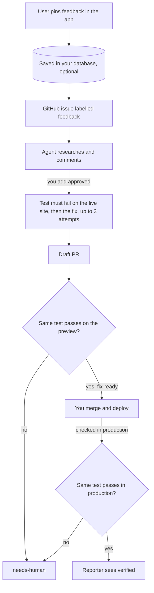

# Make your users your testers

An open-source kit for one person, or a small team, who builds an app with coding agents and has real users. Your users point at what is broken. An agent turns each report into an issue with research, you approve it, and the agent opens a draft PR with a test that fails on the live site. On the preview of the fix the same test passes. After you deploy, it runs against production and the reporter sees "verified".

## Paste this into your coding agent

> Read https://github.com/AgasiArgent/user-driven-development/blob/main/SETUP.md and set it up in this app.

The agent reads [SETUP.md](SETUP.md), asks you a few questions and installs the pieces. You review what it did.

## What you get



- A **Feedback button** (a widget) for your app. The user clicks the broken element and writes what is wrong.
- Four GitHub workflows: research on each report, a fix whose test must fail on the live site first and pass on the preview, and a check in production after you deploy.
- A weekly session: tell your agent "run WEEKLY.md" and it collects what is stuck and asks you the product questions, all at once. See [WEEKLY.md](WEEKLY.md).
- Three weekly routines that open draft PRs or issues: dead code, duplicates and a security review. See [ROUTINES.md](ROUTINES.md).

## See it working

The kit was installed by a fresh coding agent, from the sentence above, into two throwaway apps. Each has one planted bug that a user reported through the widget:

- [udd-accept-next](https://github.com/AgasiArgent/udd-accept-next) (Next.js + Supabase): [the report](https://github.com/AgasiArgent/udd-accept-next/issues/1), the agent's research, [the fix](https://github.com/AgasiArgent/udd-accept-next/pull/2), then "verified in production". [A report about a feature that works](https://github.com/AgasiArgent/udd-accept-next/issues/5) ends with the agent finding nothing to change and asking a human.
- [udd-accept-vite](https://github.com/AgasiArgent/udd-accept-vite) (Vite + Express): [the report](https://github.com/AgasiArgent/udd-accept-vite/issues/1) and [the fix](https://github.com/AgasiArgent/udd-accept-vite/pull/2), plus [a pull request from the duplicates routine](https://github.com/AgasiArgent/udd-accept-vite/pull/3).

## Where it comes from

I'm not a software engineer by training. I ran businesses and sales teams. Today I build, on my own and with coding agents, the ERP of a company of about 200 people. About 30 people send me feedback, and I am the only developer.

The loop did not work well at first. Of the fixes I sent for review, about 30% came back for rework in July, 13% in August and 6% in September. The rules below are what changed in between.

- In numbers: the loop itself brought 121 of 479 issues to completion over 14 weeks, about one in four.
- A weekly session handles the rest. 467 of 529 issues sent to the coding agent are done (88%).
- At one point there were 12 days of downtime with no errors: the loop ran and produced nothing. That is why [rule 10](RULES.md) says to watch what the loop produces.

## The rules

[RULES.md](RULES.md) has all 15, each with the failure that led to it and the file in this kit that enforces it. The short version:

1. A report is saved before anything else happens.
2. Research comes before the issue, and agent text is cleaned.
3. A person approves before any code is written.
4. Some paths are never changed automatically.
5. The test that reproduces the problem is written first. It must fail on the live site first and pass on the preview.
6. Three attempts, then a person.
7. Done means the test passes in production.
8. One run per issue.
9. The agent stops at a draft PR.
10. Watch what the loop produces.
11. The reporter sees the status.
12. The automation acts as a bot.
13. A routine has one open item and remembers a no.
14. A security finding comes first, the fix after approval.
15. Findings in a public repository stay local.

## What it costs

- **Model.** The workflows run on your Claude Pro or Max subscription through a token from `claude setup-token`. An API key also works. Nothing runs before you add `approved`, except the research on each new report and the weekly routines.
- **GitHub Actions minutes.** GitHub Actions is free for public repositories on standard GitHub-hosted runners. For private repositories, GitHub's plan table lists 2,000 minutes per month on the Free plan, and the minutes used reset to zero at the start of each month. Larger runners are always charged, even in public repositories. Source: [About billing for GitHub Actions](https://docs.github.com/en/billing/managing-billing-for-github-actions/about-billing-for-github-actions).

## Limits

- The red run on production is a signal, not proof. The test is written by the agent, so a test that fails on the live site can still miss the real problem. What you can rely on: a patch check (each fix has exactly one test tagged `@udd-<n>` and a change to app code), the same test passing on the preview of the fix, a draft PR, and your own review before you merge.
- A red check proves the test fails on the live site, not that it is the reported bug. When the agent finds nothing to change, the loop stops and asks you (no retries). Review every draft PR against the report.
- Pull requests opened by the workflows use `GITHUB_TOKEN`, so your own CI does not run on them automatically. Run CI by hand before merging, or configure a GitHub App token. The preview check is a separate workflow and still runs.
- The tests run against production and the preview under a test account. Give it no real data and no admin rights.
- In a public repository every user report becomes a public issue. Users should not report secrets or personal data. The agent's research comment is cleaned, but it is public too. Security checks run only on your machine there.
- **Preview deployments run the agent's code.** On Vercel every pushed `udd/fix-*` branch is built and deployed before you review it. The Preview environment must hold no production secrets: a separate Supabase project (or only the anon key with RLS on), no service-role key, no `UDD_GITHUB_TOKEN`, no payment or email keys scoped to Preview. [SETUP.md](SETUP.md) section 8b says how to check.
- The `approved` label is the gate, but anyone holding a token with issue write access can add it too, including `UDD_GITHUB_TOKEN` on your app server. Keep that token on the server only, and rotate it if the server is compromised.
- The agent's file access is limited to the repository checkout by permission rules (see the comment at the top of `udd-fix.yml`). That is a permission rule, not a sandbox.
- Research runs automatically on every report, with no approval. `UDD_RESEARCH_DAILY_CAP` (default 20) limits how much of your subscription that can use per day.
- The database step is optional. Without one, a report can be lost if GitHub is down.
- The preview and production checks start from GitHub `deployment_status` events. Vercel now recommends its `repository_dispatch` events instead; switching to them is open work.

## Try it first

You need Docker.

```bash
git clone https://github.com/AgasiArgent/user-driven-development.git
cd user-driven-development
docker compose up --build
```

Open http://localhost:3100. It is **Roomly**, a small room-booking app with four [seeded bugs](docs/demo-bugs.md). Press **Feedback** in the bottom-right corner, click an element, describe the problem and send. The report gets an ID like `FB-1` and appears under **My feedback** with the status `received`.

> The demo intake has no authentication and no rate limit. That is fine on localhost and wrong in production.

## Advanced: how I run it in production

The kit above is a smaller version of what runs in my own system. The full version has its own queue table, a dispatcher on a server, Linear and Codex Cloud.

- [Full level](docs/full-level.md): the reference implementation, tested against fakes.
- [Case study](docs/case-study.md): four generations in one real system, with numbers.
- [Threat model](docs/threat-model.md): feedback is untrusted input to an agent.
- [Templates reference](docs/basic-level.md): what each file the agent installs does.
- [Origin of the rules](docs/concept.md)

## Repository layout

| Path | What it is |
|---|---|
| `SETUP.md`, `WEEKLY.md`, `ROUTINES.md` | Instructions your agent follows |
| `RULES.md` | The playbook |
| `templates/` | Workflows, scripts, routine prompts and a `CLAUDE.md` snippet that the agent copies into your app |
| `widget/` | The feedback widget: TypeScript, no framework, built to one file |
| `delivery/` | Moves saved reports into GitHub Issues and mirrors their status back |
| `contracts/` | JSON Schema of a feedback report |
| `demo/` | Roomly, a Next.js and Postgres demo app |
| `full/` | The full level |
| `.github/workflows/`, `.udd/` | This repository's own copy of the workflows and scripts, configured for the demo |
| `docs/` | Reference, case study, threat model |

## Contributing

Reports from other systems are the most useful contribution. See [CONTRIBUTING.md](CONTRIBUTING.md).

## License

[MIT](LICENSE)
