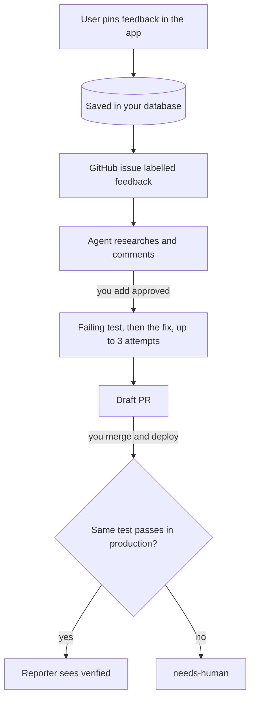

# Make your users your testers

An open-source kit for one person, or a small team, who builds an app with coding agents and has real users. Your users point at what is broken. An agent turns each report into an issue with research, you approve it, and the agent opens a draft PR with a test that fails on the old code. After you deploy, the same test runs against production and the reporter sees "verified".

## Paste this into your coding agent

> Read https://github.com/AgasiArgent/user-driven-development/blob/main/SETUP.md and set it up in this app.

The agent reads [SETUP.md](SETUP.md), asks you a few questions and installs the pieces. You review what it did.

## What you get



- A **Report a problem** widget for your app. The user clicks the broken element and writes what is wrong.
- Three GitHub workflows: research on each report, a fix with a failing test first, and a check in production after you deploy.
- A weekly session: tell your agent "run WEEKLY.md" and it collects what is stuck and asks you the product questions, all at once. See [WEEKLY.md](WEEKLY.md).
- Three weekly routines that open draft PRs or issues: dead code, duplicates and a security review. See [ROUTINES.md](ROUTINES.md).

## Where it comes from

I'm not a software engineer by training. I ran businesses and sales teams. Today I build, on my own and with coding agents, the ERP of a company of about 200 people. About 30 people send me feedback, and I am the only developer.

The loop did not work well at first. Of the fixes I sent for review, about 30% came back for rework in July, 13% in August and 6% in September. The rules below are what changed in between.

- Over 14 weeks the loop marked 121 of 479 dispatched issues as shipped on its own, about one in four.
- A weekly session handles the rest. Of 529 issues sent to the coding agent, 467 (88%) are done.
- At one point it ran for 12 days without errors while producing nothing. That is why [rule 10](RULES.md) says to watch what the loop produces.

## The rules

[RULES.md](RULES.md) has all 15, each with the failure that led to it and the file in this kit that enforces it. The short version:

1. A report is saved before anything else happens.
2. Research comes before the issue, and agent text is cleaned.
3. A person approves before any code is written.
4. Some paths are never changed automatically.
5. The test that reproduces the problem is written first and must fail on the old code.
6. Three attempts, then a person.
7. Done means the test passes in production.
8. One run per issue.
9. The agent stops at a draft PR.
10. Watch what the loop produces.
11. The reporter sees the status.
12. The automation acts as a bot.
13. A routine has one open item and remembers a no.
14. A security finding comes first, the fix after approval.
15. Findings in a public repository stay local.

## What it costs

- **Model.** The workflows run on your Claude Pro or Max subscription through a token from `claude setup-token`. An API key also works. Nothing runs before you add `approved`, except the research on each new report and the weekly routines.
- **GitHub Actions minutes.** GitHub Actions is free for public repositories on standard GitHub-hosted runners. For private repositories, GitHub's plan table lists 2,000 minutes per month on the Free plan, and the minutes used reset to zero at the start of each month. Larger runners are always charged, even in public repositories. Source: [About billing for GitHub Actions](https://docs.github.com/en/billing/managing-billing-for-github-actions/about-billing-for-github-actions).

## Try it first

You need Docker.

```bash
git clone https://github.com/AgasiArgent/user-driven-development.git
cd user-driven-development
docker compose up --build
```

Open http://localhost:3100. It is **Roomly**, a small room-booking app with four [seeded bugs](docs/demo-bugs.md). Press **Feedback** in the bottom-right corner, click an element, describe the problem and send. The report gets an ID like `FB-1` and appears under **My feedback** with the status `received`.

> The demo intake has no authentication and no rate limit. That is fine on localhost and wrong in production.

## Advanced: how I run it in production

The kit above is a smaller version of what runs in my own system. The full version has its own queue table, a dispatcher on a server, Linear and Codex Cloud.

- [Full level](docs/full-level.md): the reference implementation, tested against fakes.
- [Case study](docs/case-study.md): four generations in one real system, with numbers.
- [Threat model](docs/threat-model.md): feedback is untrusted input to an agent.
- [Templates reference](docs/basic-level.md): what each file the agent installs does.
- [Origin of the rules](docs/concept.md)

## Repository layout

| Path | What it is |
|---|---|
| `SETUP.md`, `WEEKLY.md`, `ROUTINES.md` | Instructions your agent follows |
| `RULES.md` | The playbook |
| `templates/` | Workflows, scripts, routine prompts and a `CLAUDE.md` snippet that the agent copies into your app |
| `widget/` | The feedback widget: TypeScript, no framework, built to one file |
| `delivery/` | Moves saved reports into GitHub Issues and mirrors their status back |
| `contracts/` | JSON Schema of a feedback report |
| `demo/` | Roomly, a Next.js and Postgres demo app |
| `full/` | The full level |
| `.github/workflows/`, `.udd/` | This repository's own copy of the workflows and scripts, configured for the demo |
| `docs/` | Reference, case study, threat model |

## Contributing

Reports from other systems are the most useful contribution. See [CONTRIBUTING.md](CONTRIBUTING.md).

## License

[MIT](LICENSE)
